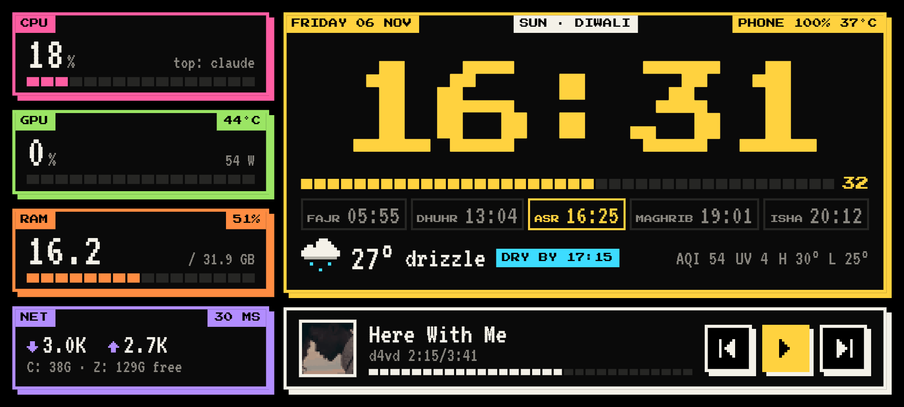
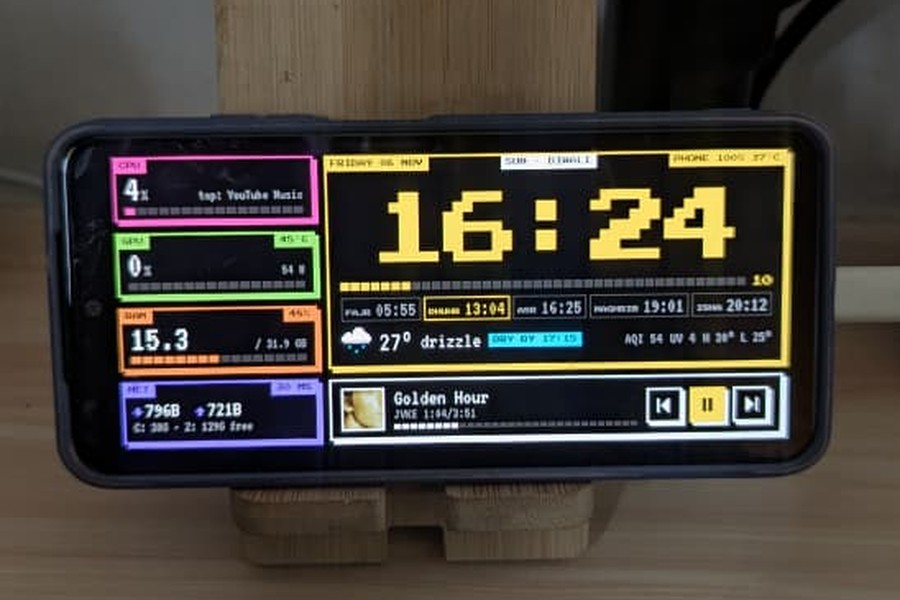
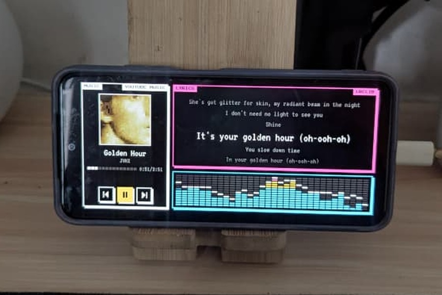
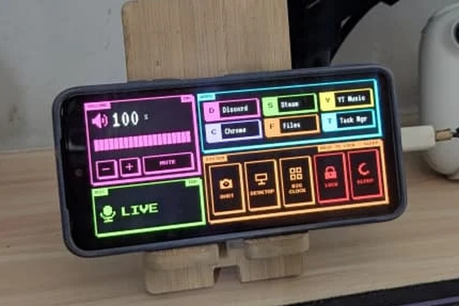
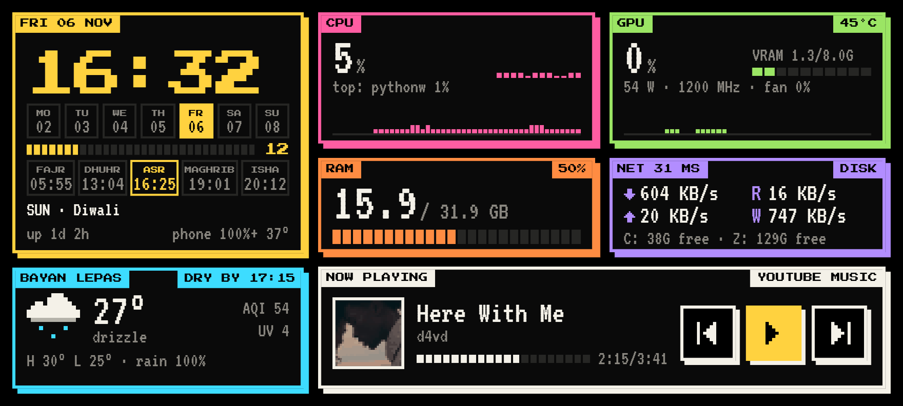
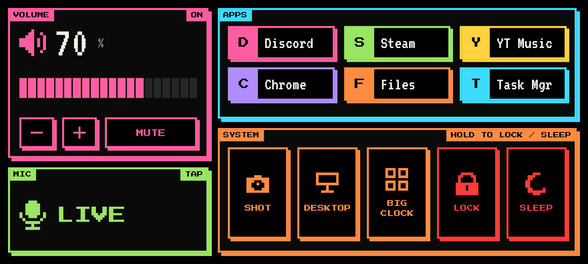

<div align="center">

# PixelDeck

**Turn an old Android phone into a retro-pixel desk dashboard for your Windows PC.**




</div>

Plug an old phone into your PC with a USB cable and it becomes a desk screen: a big pixel clock, live PC stats, weather, prayer times, your next calendar event and what's playing. No Wi-Fi setup, and nothing exposed to your network.

<table>
  <tr>
    <td width="33%"></td>
    <td width="33%"></td>
    <td width="33%"></td>
  </tr>
  <tr>
    <td align="center"><b>Clock</b></td>
    <td align="center"><b>Music</b></td>
    <td align="center"><b>Controls</b></td>
  </tr>
</table>

<table>
  <tr>
    <td width="50%"></td>
    <td width="50%"></td>
  </tr>
  <tr>
    <td align="center"><b>Classic clock layout</b></td>
    <td align="center"><b>Control page</b></td>
  </tr>
</table>

## Features

- **Clock**: big pixel clock, phone battery, prayer times (Malaysia, optional) and your next calendar event
- **PC stats**: CPU, NVIDIA GPU, RAM, network, free disk space, and internet ping with an offline alert
- **Weather**: forecast with a 2-hour rain alert, air quality and UV
- **Music**: now playing with ⏮ ⏯ ⏭, synced lyrics and a live visualizer
- **Controls**: PC volume, mic mute, app shortcuts, screenshot, show desktop, lock and sleep
- **Screen care**: pixel shifting, night and idle dimming, and a moving clock when the PC is locked

## How it works

```
 Windows PC                          USB cable               Phone
 Python agent on 127.0.0.1:8765  ◄── adb reverse ──►  Chrome web app, fullscreen
```

A small Python agent on the PC collects the data and serves a web page. The phone opens it through the USB cable, and it updates every second. The agent only listens on your PC, and the app buttons only run commands you put in `config.json`.

## Setup

You need Windows 10/11, Python 3.11+, [adb](https://developer.android.com/tools/releases/platform-tools), and an Android phone with Chrome and USB debugging turned on.

```powershell
git clone https://github.com/danishayman/PixelDeck.git
cd PixelDeck
python -m venv .venv
.\.venv\Scripts\python.exe -m pip install -r requirements.txt
copy config.example.json config.json
.\scripts\install-autostart.ps1    # start at every logon
.\scripts\restart-agent.ps1        # start now
```

Then on the phone:

1. Plug it in, unlock it, and allow USB debugging if asked.
2. Open `http://localhost:8765` in Chrome.
3. Chrome menu (⋮) → **Add to Home screen** → **Install**. Open **PixelDeck** and turn the phone sideways.

That's it. From now on the agent starts when you log in and opens the app whenever the phone is plugged in.

## Using it

| Do this | To |
| --- | --- |
| Swipe left or right | Switch between the clock, music and control pages |
| Tap the clock | Switch 12 / 24 hour time |
| Hold the clock for 2 s | Reload the page |
| Hold LOCK or SLEEP for 1 s | Lock or sleep the PC |

## Configuration

Edit `config.json`, then run `.\scripts\restart-agent.ps1`. The settings you'll most likely change:

| Setting | What it does |
| --- | --- |
| `city` | Weather location (or set `latitude` and `longitude`) |
| `prayer_zone` | JAKIM zone code, e.g. `PNG01` for Penang. Leave empty to hide prayer times |
| `calendar.ics` | iCal links to show events from (see below) |
| `apps` | Your own app buttons, up to six (see below) |
| `clock_24h`, `layout` | Clock format, and style: `"bigclock"` or `"classic"` |
| `night_dim`, `idle_dim_minutes` | When to dim the screen |

All settings and their defaults are in [`agent/config.py`](agent/config.py).

**Google Calendar:** in Google Calendar's settings, open your calendar → **Integrate calendar** and copy the **Secret address in iCal format** into `calendar.ics`.

> [!WARNING]
> That address lets anyone read your calendar, so keep it private. `config.json` is git-ignored for this reason.

**App buttons:** each one has a `label` and either `run` (a program) or `open` (a link, file or folder):

```json
"apps": [
  { "label": "Steam", "open": "steam://open/main" },
  { "label": "Discord", "run": "C:\\Users\\you\\AppData\\Local\\Discord\\Update.exe", "args": "--processStart Discord.exe" }
]
```

## Troubleshooting

- **Phone says "PC offline"**: run `adb devices` and check the phone shows as `device`, then look in `logs\agent.log`.
- **Nothing on port 8765**: run `.\scripts\restart-agent.ps1`, or `.\.venv\Scripts\python.exe -m agent` to see errors.
- **Weather error**: check `city` in `config.json`.

<details>
<summary><b>Optional: CPU temperature</b></summary>

Windows often can't read CPU temperature on its own. Install LibreHardwareMonitor (`winget install LibreHardwareMonitor.LibreHardwareMonitor`), then run this from the project folder and accept the admin prompt:

```powershell
$exe = (Get-ChildItem "$env:LOCALAPPDATA\Microsoft\WinGet\Packages\LibreHardwareMonitor*" -Recurse -Filter LibreHardwareMonitor.exe).FullName
Start-Process powershell -Verb RunAs -ArgumentList "-ExecutionPolicy Bypass -File `"$PWD\scripts\setup-lhm.ps1`" -Exe `"$exe`" -User `"$env:USERDOMAIN\$env:USERNAME`""
```

</details>

<details>
<summary><b>Good to know</b></summary>

- **Burn-in:** AMOLED screens can burn in. PixelDeck shifts and dims the layout to help, but make `night_dim` longer or stronger if you see ghosting.
- **Battery:** being plugged in all the time wears the battery. Keep the phone somewhere airy and unplug it if it ever swells.
- **Unlocked phone:** the screen stays on and unlocked, so anyone at your desk can swipe into your other apps.
- **Vibration:** Chrome won't vibrate while the phone is on silent or Do Not Disturb.

</details>

<details>
<summary><b>Uninstall</b></summary>

1. Run `.\scripts\uninstall-autostart.ps1`. The agent stops for good the next time you sign out.
2. On the phone, long-press **PixelDeck** → Uninstall.
3. Delete the project folder.

</details>

## Credits

Weather from [Open-Meteo](https://open-meteo.com), lyrics from [LRCLIB](https://lrclib.net), prayer times from [JAKIM e-Solat](https://www.e-solat.gov.my). Fonts: Press Start 2P, VT323 and DotGothic16 under the [SIL Open Font License](web/fonts/OFL.txt).

## License

[MIT](LICENSE) © 2026 danishayman
